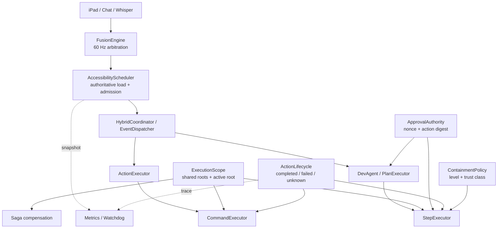
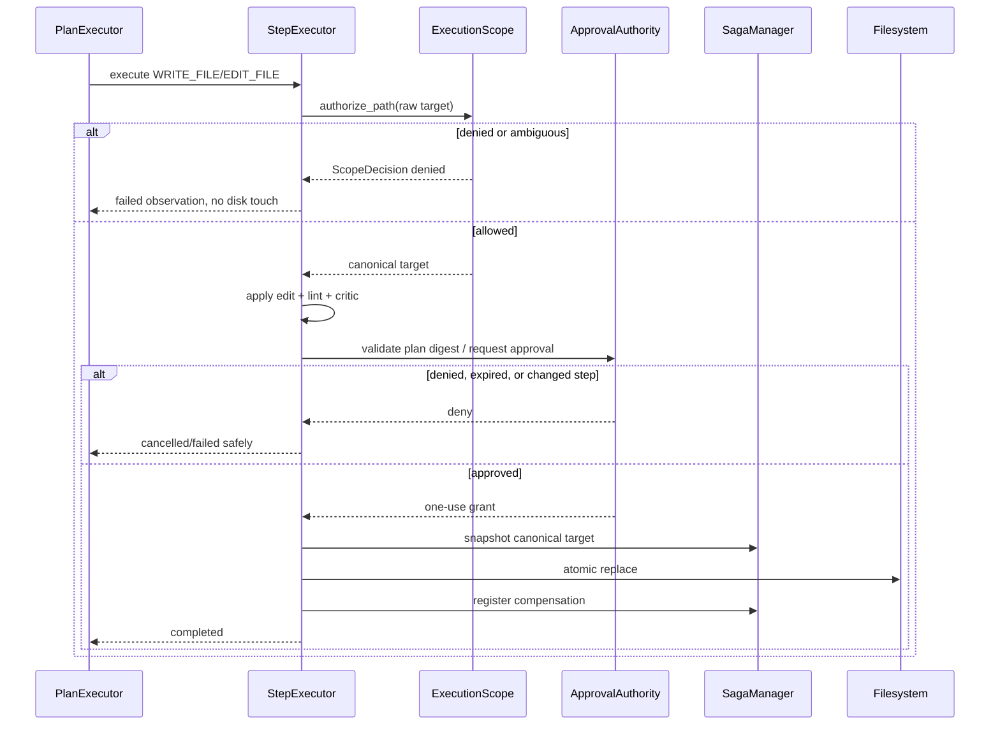
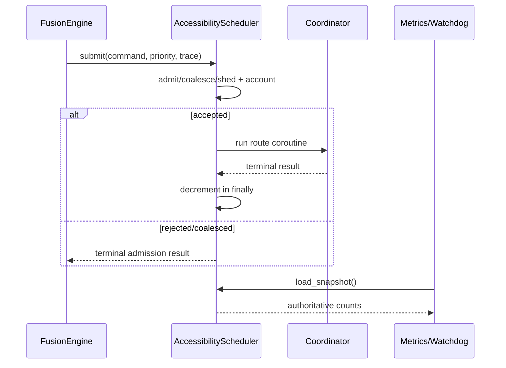

# Design: Harness Boundary Hardening

**Spec:** [requirements.md](requirements.md)  
**Status:** Building — Gates 1 and 2 approved  
**Approved:** Brad, 2026-09-27  
**Author:** Kiro, 2026-09-27

---

## 1. Design Summary

Keep the current harness layers and make five boundaries authoritative:

1. one shared `ExecutionScope` for all filesystem and terminal paths;
2. `AccessibilityScheduler` as the single source of queued/running load;
3. an explicit action lifecycle that includes `outcome_unknown`;
4. nonce- and digest-bound destructive approval;
5. an explicit terminal `ContainmentLevel` used by admission policy.

The design is additive and surgical. It does not move I/O or inference into the
60 Hz loop, add a model, replace the coordinator, alter pain-day thresholds, or
replace the existing saga mechanism.



---

## 2. Current Boundaries to Preserve

| Existing boundary | Preserve |
|---|---|
| `FusionEngine` | deterministic sensor arbitration, direct cursor paths, deadline-based 60 Hz loop |
| `AccessibilityScheduler` | priority ordering, one heavy-work permit, separate fan-out pool, flare pause |
| `EventDispatcher` | dev/command split, Gates 0–4, pain-day snapshot, persistence and metrics |
| `PlanExecutor` | bounded plan repair/replan, durable run ledger, DAG semantics, cancellation |
| `StepExecutor` | edit-format/lint/critic/tester ordering and verb dispatch |
| `CommandExecutor` | target grounding, desktop verification, idempotency and audit |
| Saga manager | per-file snapshots and reverse compensation; no whole-tree stash |
| `ResourceGovernor` | model eviction and dev admission during flares |

The refactor SHALL reuse these components. Whole-module regeneration is out of
scope.

---

## 3. Component Contracts

### 3.1 `ExecutionScope`

**Proposed location:** `core/execution_policy.py`

`ExecutionScope` replaces duplicated ownership of `_writable_roots` and
`_active_root`. It is instantiated once per production pipeline and injected
into every component that can create a filesystem/process side effect.

```python
@dataclass(frozen=True)
class ScopeDecision:
    allowed: bool
    canonical_path: Path | None
    root: Path | None
    reason: str | None

class ExecutionScope:
    def roots(self) -> tuple[Path, ...]: ...
    def active_root(self) -> Path | None: ...
    def add_root(self, path: str, *, human_confirmed: bool) -> ScopeDecision: ...
    def set_active_root(self, path: str, *, human_confirmed: bool) -> ScopeDecision: ...
    def authorize_path(self, path: str, *, operation: str) -> ScopeDecision: ...
    def authorize_cwd(self, cwd: str | None) -> ScopeDecision: ...
```

#### Canonicalization algorithm

1. Reject empty and NUL-containing paths.
2. Expand `~` and environment-neutral user aliases already supported by current
   configuration.
3. Resolve relative paths against the current active root, otherwise the
   configured repository root.
4. Normalize drive and case semantics on Windows.
5. Resolve every existing ancestor to detect symlink/junction escape.
6. For a new leaf or parent, resolve the nearest existing ancestor, then append
   the normalized non-existing suffix.
7. Compare with each canonical root using `os.path.commonpath`; a drive mismatch
   is denial, not an exception that widens scope.
8. Return the canonical path in `ScopeDecision`; downstream code SHALL use that
   returned path rather than re-parsing the original string.

`ExecutionScope` owns mutable root state on the asyncio event-loop thread. Reads
on the hot path return immutable tuple/snapshot data and perform no DB or network
I/O. Root additions remain explicitly human-confirmed.

#### WSL action-proxy scope transfer and request authentication

The WSL sender authorizes and canonicalizes every proxied file target or terminal
cwd before forwarding it. The private loopback HTTP request carries the selected
canonical Windows path and its exact containing root in a versioned internal
preauthorization envelope. The Windows receiver constructs a request-scoped
`ExecutionScope` containing only that root and reauthorizes the forwarded path.
Missing, mismatched, non-canonical, or widening envelopes fail closed. This
contract is internal to the WSL/Windows proxy and does not change iPad WebSocket
payloads.

The proxy bootstrap token is stored in the sibling
`E:\Personal_Desktop_Agent-secrets` directory, outside `PROJ_ROOT`, with Windows
ACL inheritance removed and a newly constructed protected DACL containing only
the current Windows SID. The launcher verifies that exclusive DACL after applying
it to both the directory and token file. `/ready` accepts only a 128-bit
hexadecimal challenge and returns a random per-process `instance_id` plus
`HMAC-SHA256(token, challenge + instance_id)`; both launchers parse the JSON and
verify that proof before enabling proxy routing. The fixed challenge grammar is
disjoint from the newline-delimited `/execute` MAC domain. WSL exposes the token
and verified instance only to `CommandExecutor` module initialization, which
captures and removes both environment variables before any child process starts.

Every `/execute` body uses deterministic JSON and is authenticated by
`HMAC-SHA256` over newline-delimited method, path, SHA-256 body hash, integer
timestamp, 128-bit nonce, and server `instance_id`. The receiver validates the
instance, a 30-second clock window, nonce format/replay state, and signature
before parsing command JSON. Authenticated nonces enter a bounded 4,096-entry
cache. No bearer token is transmitted; replacement listeners can observe only
instance-bound, time-bounded, one-use proofs. Sandbox, detached-process, timeout
helper, and git/gh environments explicitly remove proxy token/instance variables
while preserving ordinary tool credentials.

#### File-edit order

```text
plan step
  -> authorize canonical target
  -> read/apply edit and lint
  -> critic (when enabled)
  -> build exact action digest / approval card
  -> validate existing plan grant or request approval
  -> snapshot canonical target
  -> atomic write canonical target
  -> register compensation
  -> optional tester
```

Scope authorization occurs before any read-for-edit, diff, snapshot, directory
creation, write, restore, or delete. A denial returns a failed step observation
without touching disk.

#### Saga behavior

Compensation records SHALL store the canonical target selected by
`ExecutionScope`. Restore/delete SHALL reauthorize that path at execution time.
If a root was removed or changed after the forward write, compensation SHALL
fail closed and escalate as an incomplete rollback rather than escaping the
current scope.

### 3.2 Scheduler accounting and admission

**Primary location:** `core/scheduler.py`  
**Consumers:** `core/fusion_engine.py`, watchdog, metrics, DevAgent

```python
@dataclass(frozen=True)
class SchedulerLoadSnapshot:
    queued_total: int
    running_total: int
    queued_by_priority: Mapping[Priority, int]
    running_by_priority: Mapping[Priority, int]
    parked_dev: int
    shed_total: int

@dataclass(frozen=True)
class AdmissionDecision:
    accepted: bool
    reason: str | None
    coalesced: bool = False
```

The scheduler tracks a small internal record for every submitted item:
priority, source/label, enqueue time, trace ID, and lifecycle state. Counts are
updated in `try/finally` around dequeue, task creation, terminal completion, and
cancellation.

`load_snapshot()` is synchronous, allocation-light, and I/O-free. Fusion may read
it, but admission remains a scheduler decision.

#### Source-aware overload order

1. pause/shed new BACKGROUND work;
2. pause/shed new DEV_AGENT work using existing queue and parked bounds;
3. coalesce provably duplicate or stale VOICE/GESTURE work;
4. preserve reserved capacity for direct ACCESSIBILITY work;
5. if the hard process-safety ceiling is reached, deny the newest nonessential
   fast-lane item, record the source/reason, and keep the loop alive.

The production ceilings are constructor-injected `SchedulerConfig` values selected
from the pre-PR 2B evidence anchors and verified with the deterministic saturation
harness. They are intentionally centralized rather than repeated at call sites:

| Setting | Default | Existing evidence and rationale |
|---|---:|---|
| `background_limit` | 10 | Matches the existing watchdog warning boundary, so background work sheds before load reaches the previously operator-visible concern point. |
| `dev_agent_limit` | 16 | Matches the existing parked-heavy cap; queued, semaphore-waiting, running, and parked heavy work now share one bounded admission population. |
| `non_accessibility_limit` | 21 | Preserves the effective old degraded breaker bound: 21 tasks were admitted, and the next submission observed `> 20` and opened the breaker. |
| `accessibility_reserve` | 16 | Keeps a full parked-cap-sized block explicitly unavailable to VOICE/GESTURE/DEV/BACKGROUND work, including during pain-day pause. |
| `hard_limit` | 256 | Converts the prior 256 pending-queue bound into an actual queued-plus-running process ceiling instead of allowing the worker to drain it into unbounded off-queue tasks. |
| voice / gesture stale windows | 2.5 s / 0.8 s | Retains the old voice single-flight window and the gesture processor's existing debounce horizon, but uses them only to expire queued work; exact identity is required for coalescing. |

The harness demonstrates why the old 256 queue check was not a total bound: the
worker could immediately transfer every item into separately tracked running or
semaphore-waiting tasks. Tiny injected limits prove the new total remains bounded,
BACKGROUND denies before DEV_AGENT, non-accessibility work cannot consume the
reserve, and the hard ceiling is absolute. The defaults preserve the established
operational envelopes rather than claiming unperformed hardware throughput
measurements; the separate 60 Hz hardware soak remains a manual rollout gate.
Pain-day state may reduce heavy-work admission but SHALL NOT reduce accessibility
reserve.

#### Fusion degraded path

When no scheduler is wired, Fusion retains a local tracked-task set solely for
its documented degraded direct dispatch. The normal production breaker reads
scheduler admission/accounting and no longer treats Fusion's fallback set as the
primary truth.

Ignored scheduler futures receive a done callback that retrieves/logs an
exception without changing awaitability for callers that do await them.

### 3.3 Action lifecycle and timeout registry

**Proposed location:** `core/action_lifecycle.py`  
**Consumers:** `CommandExecutor`, `StepExecutor`, `PlanExecutor`, tracing/audit

```python
class ActionStatus(str, Enum):
    COMPLETED = "completed"
    FAILED = "failed"
    OUTCOME_UNKNOWN = "outcome_unknown"

@dataclass(frozen=True)
class ActionOutcome:
    status: ActionStatus
    action: str
    trace_id: str
    result: Any = None
    error: str | None = None
    reconciliation: str | None = None
```

The internal typed outcome is converted at the current external dict boundary to
avoid an unnecessary protocol change. A protocol version is required only if an
external producer/consumer must receive the new state directly.

#### Threaded action sequence

```text
create tracked asyncio Task around asyncio.to_thread(...)
  -> await shield(task) with caller timeout
      -> completed: normal observation
      -> raised before timeout: failed
      -> timeout while worker continues: outcome_unknown
           -> keep bounded registry entry
           -> do not retry destructive action
           -> done callback records late completion
           -> reconcile using tool-specific observer
```

`asyncio.shield` intentionally prevents timeout cancellation from discarding the
handle to the still-running worker. The registry has a strict bound and expiry;
if either is exceeded, new side-effecting work fails safe rather than losing
track of another unknown action.

#### Plan behavior

- Read-only unknown outcomes may use existing bounded retry only when the
  operation is idempotent and no side effect is possible.
- Destructive unknown outcomes stop the destructive branch. The plan MAY wait for
  a short bounded reconciliation window, but SHALL NOT replan into another
  destructive action while the result is unknown.
- If reconciliation remains impossible, finalize the run as interrupted/unknown
  with a concise user-visible explanation and preserve recovery context.

No schema change is expected: existing text status/result fields can represent
these states. If implementation disproves this, schema work stops and follows
the dedicated schema-change procedure using `storage/schema/agent.py`.

#### Atomic file write

Write the completed content to a temporary file in the destination directory,
flush and close it, then use `os.replace` to replace the target atomically. The
saga snapshot remains pre-write. Temporary files are uniquely named and cleaned
on error. Existing file permissions are preserved where practical.

#### Terminal cancellation

Terminal execution uses the existing capped subprocess boundary but retains the
process handle and kills the process tree on timeout. Windows uses the available
job/process-tree mechanism; POSIX/WSL uses a process group. A timeout is `failed`
only after termination is verified; otherwise it is `outcome_unknown`.

### 3.4 Approval authority

**Proposed location:** `core/approval_authority.py`  
**Consumers:** upfront plan gate, StepExecutor, voice/chat/iPad responders

```python
@dataclass(frozen=True)
class ApprovalRequest:
    request_id: str
    trace_id: str
    action_digest: str
    description: str
    created_at: float
    expires_at: float

@dataclass(frozen=True)
class ApprovalResponse:
    request_id: str
    action_digest: str
    decision: Literal["approve", "deny"]
    responded_at: float

@dataclass(frozen=True)
class ApprovalGrant:
    request_id: str
    trace_id: str
    approved_digests: tuple[str, ...]
    expires_at: float
```

#### Digest construction

The digest is SHA-256 over canonical JSON containing the action name, canonical
path/cwd, security-relevant args, final resolved file-content hash, and dependency
identity. Skill sends use the same parsed and secret-scrubbed skill/tool/argument
material for both approval and execution. A whole-plan request contains the ordered
sequence of per-step digests, preserving duplicates, plus the goal and trace ID.
Presentation text is not authority.

At execution, the authority atomically claims only the next expected digest and
consumes each sequence position once. Completed claims are discarded immediately;
partial grants are revoked when their plan ends, and expiry claims remove abandoned
state. Destructive DAG steps run serially in approved plan order; read-only fan-out
remains concurrent. Grant use and response timestamps must be strictly earlier than
`expires_at`.

A replan may reuse approval only for an exactly matching next approved digest. Any
new or changed destructive step requires a new request, even if its verb appeared in
the original plan. WRITE_FILE/EDIT_FILE recompute their final candidate from current
target state before claiming; candidate drift therefore requires per-operation
approval, and no candidate is written before authority succeeds.

#### File protocol

Use per-request paths rather than a global response value:

```text
~/.claude/approval/requests/<request_id>.json
~/.claude/approval/responses/<request_id>.json
```

Writers create a temporary file in the same directory and atomically replace the
final path. The authority checks nonce, digest, expiry, and one-use state before
consuming the response. Malformed/mismatched/expired records are denied and
quarantined or removed.

The migration may temporarily read the legacy response only when exactly one
legacy-compatible request is active, but legacy acceptance is observable and
removed after voice, chat, hook, and iPad channels are updated. If the WebSocket
payload gains `request_id`/`action_digest`, Python and Swift change together.

### 3.5 Containment policy

**Primary location:** `inference/sandbox.py` with a small policy façade available
to StepExecutor and runtime status.

```python
class ContainmentLevel(IntEnum):
    NATIVE_UNCONFINED = 0
    CWD_AND_RESOURCE_LIMITS = 1
    NAMESPACE_JAIL = 2

class WorkTrust(str, Enum):
    TRUSTED_MANUAL = "trusted_manual"
    AUTONOMOUS_OR_UNTRUSTED = "autonomous_or_untrusted"

@dataclass(frozen=True)
class ContainmentReport:
    level: ContainmentLevel
    mechanism: str
    reason: str | None
```

Detection reports the effective mechanism after platform, WSL routing, sandbox
tool availability, configuration, and path translation are considered.

Recommended policy:

```text
trusted_manual             minimum = NATIVE_UNCONFINED
                            (still requires scope + allowlist + approval)
autonomous_or_untrusted    minimum = NAMESPACE_JAIL
```

The autonomous/untrusted minimum remains an open Gate 1 decision. No new trust
model is introduced: use existing goal provenance, ContentFilter, and MCP trust
classification signals. Unknown provenance is classified conservatively.

Containment status is exposed through existing status/metrics surfaces. A state
transition may produce one quiet notification; repeated commands in the same
state do not repeat it.

---

## 4. Pipeline Sequences

### 4.1 Approved file edit



### 4.2 Timed-out side effect

```mermaid
sequenceDiagram
    participant P as PlanExecutor
    participant X as Executor
    participant R as LifecycleRegistry
    participant W as Worker

    X->>R: register trace/action
    X->>W: start tracked worker
    alt completes within budget
        W-->>X: result
        X->>R: completed
        X-->>P: completed
    else caller timeout
        X->>R: outcome_unknown
        X-->>P: stop destructive branch; do not retry
        W-->>R: late completion/failure
        R->>R: reconcile and trace final outcome
    end
```

### 4.3 Scheduler-backed dispatch



---

## 5. Wiring and File Impact

| Area | Expected change |
|---|---|
| `main.py` | construct/wire shared policy objects; no hot-loop logic |
| `core/execution_policy.py` | new scope authority and typed decisions |
| `core/command_executor.py` | consume shared scope; remove duplicate root ownership |
| `core/hybrid_coordinator.py` | pass shared scope/status through existing DI surfaces |
| `inference/dev_agent.py` | receive scope/approval/lifecycle dependencies |
| `inference/step_executor.py` | authorize before all path operations; typed outcomes |
| plan/saga executor modules | exact-digest grant checking; scope-checked compensation; unknown outcome handling |
| `core/scheduler.py` | authoritative all-priority accounting and admission |
| `core/fusion_engine.py` | consume scheduler admission/snapshot; retain degraded local tracking |
| `inference/sandbox.py` | containment report and process-tree termination evidence |
| approval gate/responders | structured nonce/digest records; bounded migration |
| iPad Swift files | only if WebSocket approval payload changes |
| monitoring/status | scheduler counts, unknown outcomes, containment level |

No `Command` DTO field is planned initially. Internal dataclasses carry the new
contracts. If an external payload must change, it is versioned and mirrored.

---

## 6. Concurrency and Failure Rules

1. `ExecutionScope` mutation occurs on the event-loop thread; canonicalization
   may be offloaded when filesystem resolution could block.
2. Fusion reads only immutable scheduler snapshots and never awaits route
   completion.
3. Scheduler counters change in `finally` on success, failure, timeout, and
   cancellation.
4. Lifecycle-registry entries hold strong references to tracked work until a
   terminal observation or expiry.
5. Approval request consumption is serialized and one-use; concurrent responders
   race safely, with at most one accepted response.
6. A policy subsystem exception denies the affected destructive action; it does
   not crash the 60 Hz loop.
7. DB/audit/metrics failures remain non-fatal but are logged; policy decisions do
   not fail open because observability is unavailable.

---

## 7. Configuration

Security invariants are not globally bypassable. Tuning values are centralized
and validated; names are illustrative until Gate 1 approval.

```yaml
harness_boundary_hardening:
  scheduler:
    observe_only: true          # initial rollout only; removal/flip requires review
    max_fast_inflight: null     # selected from saturation evidence
    accessibility_reserve: null
  lifecycle:
    reconciliation_grace_s: 2.0
    unknown_registry_limit: 32
    unknown_registry_ttl_s: 300
  approval:
    ttl_s: 60
    legacy_read_enabled: true   # migration only; final state false
  containment:
    trusted_manual_minimum: native_unconfined
    autonomous_untrusted_minimum: namespace_jail
```

`ExecutionScope` has no disable flag. Existing writable-root configuration
remains the authority for root values. Pain-day-sensitive values remain routed
through existing BehavioralTwin/ResourceGovernor logic; this feature adds no
hardcoded interaction threshold.

---

## 8. Verification Design

### 8.1 Scope boundary

- direct StepExecutor and CommandExecutor in-scope success;
- traversal, absolute escape, drive-relative path, and malformed path denial;
- symlink and Windows junction escape denial;
- nonexistent leaf under an allowed canonical parent;
- active root added once and observed by both executors;
- authenticated WSL proxy accepts that dynamic root while rejecting missing,
  mismatched, non-canonical, or widening preauthorization;
- every Git/GitHub subprocess receives the authorized active/default cwd;
- replan-injected path checked identically to initial plan;
- compensation restore/delete reauthorized and incomplete rollback escalated;
- denial before diff, snapshot, parent creation, or write.

### 8.2 Scheduler boundary

- every priority represented in queued/running counts;
- counts return to zero on result, exception, timeout, and cancellation;
- slow coordinator under synthetic voice/gesture storm remains bounded;
- duplicate/stale coalescing does not collapse distinct commands;
- accessibility reserve survives DEV/BACKGROUND saturation and pain-day pause;
- degraded no-scheduler dispatch remains bounded and non-blocking;
- ignored future exception is observed exactly once.

### 8.3 Timeout boundary

- blocking worker exceeds caller budget and yields `outcome_unknown`;
- plan performs no destructive retry/replan while unknown;
- late success/failure correlates to original trace;
- registry cap and expiry fail closed;
- atomic write either leaves old or complete new content, never partial content;
- terminal process tree is terminated and status reflects verified/unverified
  termination.

### 8.4 Approval boundary

- valid matching response accepted once;
- wrong nonce, wrong digest, expired, malformed, duplicate, and replay denied;
- two concurrent requests cannot consume each other's responses;
- changed canonical path/body after upfront approval requires new approval;
- Critic escalation gets a separate request;
- legacy migration path is observable and disabled in final-state tests;
- Python/Swift serialization parity if the bridge contract changes.

### 8.5 Containment boundary

- each platform/tool combination maps to the correct containment level;
- trusted manual work preserves documented fallback after scope/allowlist/approval;
- autonomous/untrusted work below minimum denies before process creation;
- containment status appears in runtime status and metrics;
- notification occurs only on state transition.

### 8.6 Regression gates

For each approved implementation phase:

1. run focused unit/integration tests;
2. run full pytest;
3. run model-free eval gates;
4. run plan-contract and trajectory gates when Ollama is available;
5. report unavailable model-backed validation explicitly;
6. never update a baseline only to hide a regression;
7. run documentation hygiene after shipping code.

A deterministic scheduler saturation test should assert bounded counts and
priority behavior, not fragile wall-clock timing. A separate manual soak may
observe 60 Hz watchdog behavior under representative hardware load.

---

## 9. Rollout and Rollback

1. **Scope enforcement:** mandatory and fail-closed when shipped; rollback by PR
   revert, not a runtime bypass.
2. **Scheduler:** first expose authoritative metrics in observe-only mode, record
   saturation behavior, then enable admission/coalescing in a separate reviewed
   phase.
3. **Timeout lifecycle:** introduce typed internal outcomes and compatibility
   conversion before changing controller behavior.
4. **Approval:** deploy structured writers/readers to every channel, allow a
   bounded dual-read migration, then remove legacy acceptance.
5. **Containment:** report effective level first; enforce the approved minimum for
   autonomous/untrusted work after status visibility is verified.

Each runtime phase is independently reversible and avoids destructive data
migration. Existing L515 work stays on its current uncommitted paths and is not
included in this feature's branches or commits.

---

## 10. Alternatives Considered

### Add `_path_in_scope` directly to `StepExecutor`

**Rejected as the final design:** it closes the immediate write hole but leaves
root ownership duplicated and allows future drift between executors and saga
compensation. A shared authority is the smallest design that fixes the class of
bug. A surgical emergency patch remains possible if implementation must be
split, but it must converge on `ExecutionScope` in the same approved feature.

### Track scheduler futures in Fusion's `_route_tasks`

**Rejected as the final design:** it reconnects the current breaker quickly but
creates two owners for normal production load. Scheduler-owned accounting is
more accurate for queued, parked, and running states. Fusion retains tracking
only for its no-scheduler fallback.

### Treat timeout as failure and rely on idempotency

**Rejected:** clicks, terminal commands, and many file/process effects are not
proven idempotent. Reporting uncertainty is safer than repeating an action whose
worker may still complete.

### Keep global approval files and delete stale contents before each prompt

**Rejected:** cleanup narrows but does not eliminate cross-process or stale-response
races. Binding authority to a nonce and exact digest closes the ambiguity without
adding prompts.

### Fail closed whenever a namespace jail is unavailable

**Rejected for all work:** it would disable explicitly approved personal workflows
on native Windows and conflict with the documented trusted-user threat model.
The stronger minimum applies to autonomous/untrusted execution; trusted manual
work remains scope-, allowlist-, and approval-gated.

### Introduce a database schema for approvals and lifecycle records

**Deferred:** existing files and status/result fields can support the first
implementation. Avoiding a migration reduces risk. If durable semantics prove
insufficient, schema work requires a separate approved migration design.

---

## 11. Security and Accessibility Review

- **JIA:** shared plan approval remains low-repetition; no new fine-motor workflow.
- **SVT:** denials and degradation are quiet; no sudden repeated audio or modal
  alarms.
- **Bipolar disorder:** states are explicit and consistent (`outcome_unknown`,
  containment level), reducing surprising retries or mode changes.
- **Path security:** approval never widens scope; canonical ambiguity denies.
- **Resource security:** scheduler bounds all work while retaining accessibility
  reserve.
- **Execution security:** autonomous/untrusted shell work requires the approved
  containment minimum.
- **Recovery:** unknown outcomes and incomplete compensation remain traceable and
  resumable rather than silently retried.

---

## 12. Gate State

Gate 1 passed when Brad approved this requirements/design package and selected
`namespace_jail` as the minimum for autonomous/untrusted terminal execution on
2026-09-27. Gate 2 passed when Brad approved `tasks.md` on the same date. The
specification is **Building**.
